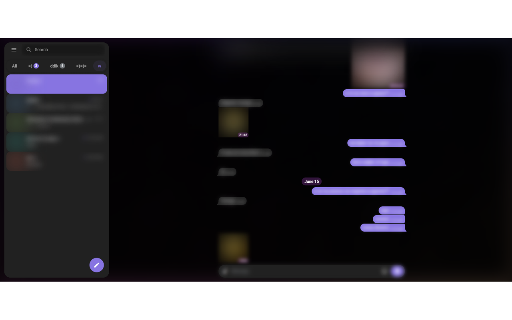
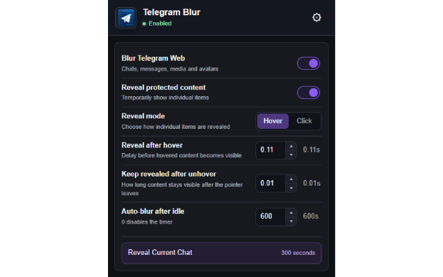

# Telegram Blur

Privacy-focused extension for blurring sensitive Telegram Web content while keeping it easy to reveal only when needed.

## Features

- Blur chat names, icons, message previews, unread counters, messages, author avatars, media, pinned messages, date badges, and other private content
- Configure the chat list, current chat, and other Telegram areas independently
- Reveal protected content by hovering over it or by pressing a configurable keyboard or mouse binding
- In click mode, reveal one item at a time or keep multiple items visible, with optional pass-through of the original button action
- Configure hover reveal delay and how long content remains visible after unhover
- Temporarily reveal or re-blur the entire current chat from the popup or with a separate configurable binding
- Automatically blur an inactive Telegram tab after a configurable idle timeout
- Configure text and media blur strength separately and optionally blur the chat background
- Toggle protection from the popup or with a configurable in-page shortcut
- Store all settings locally in the browser

## Supported Pages

- `https://web.telegram.org/*`

## Privacy

- Settings are stored locally in the browser
- The extension does not read, collect, or send Telegram messages to external servers

## Installation

- 🟢 [Chrome Web Store](https://chromewebstore.google.com/detail/pjjpgecmhadoebhgkfcnlljmmonoakap)
- 🦊 [Firefox Add-ons](https://addons.mozilla.org/firefox/addon/telegramblur/)

## Screenshots

**1. Telegram Web with private chat content blurred**

**2. Content categories, reveal modes, shortcuts, idle protection, and blur strength settings**

## Contributing

Feel free to open issues or submit pull requests to improve the extension.
